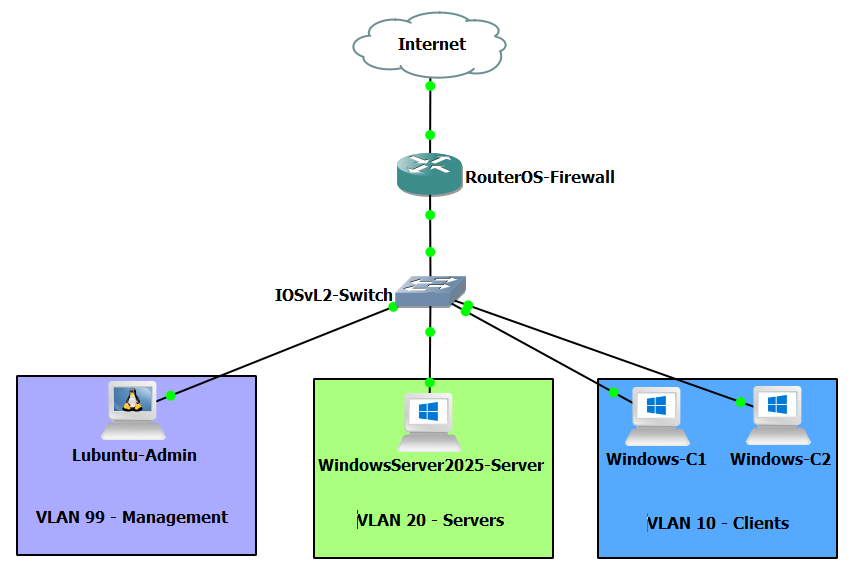
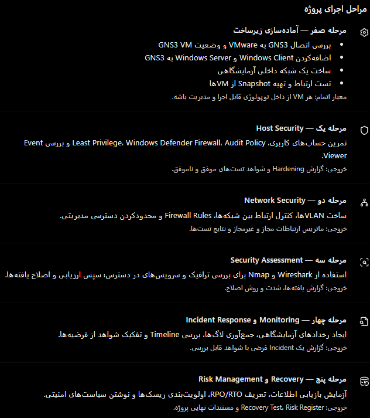

# 🔻تمرین عملی مباحث +Security

## 🔹محیط کار و توپولوژی

**GNS3**⬆️

## 🔹هدف

- با **استفاده از** مجازی‌سازی در GNS3 و VMWare Workstation محیطی طراحی کنیم که در 5 مرحله مختلف بخش خوبی از مباحث +Security رو پوشش بدیم.
    
- **هدف** از این سناریو اینه که +Security رو صرفا تئوری نگذرونده باشیم!

## 🔹اقدامات و کانفیگ‌ها

### 🔸اقدامات

### 🔸کانفیگ‌ها
#### ▫️مرحله 1

#### ▫️مرحله 2

#### ▫️مرحله 3

#### ▫️مرحله 4

#### ▫️مرحله 5

## 🔹راستی آزمایی

## 🔹مشکل

- **مشکل**م 
    
- **راه‌حل**‌ش 

## 🔹نتیجه

>
